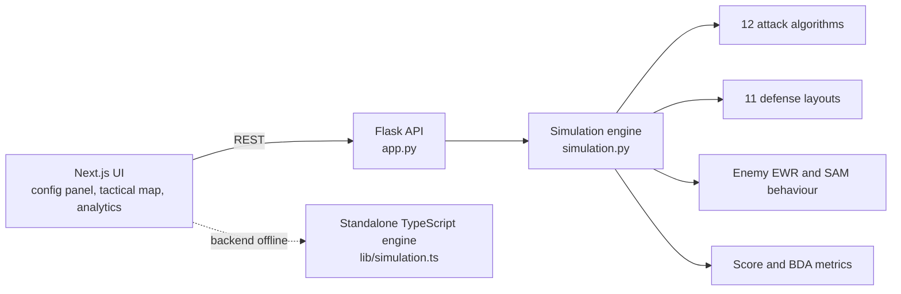

# D³AS: Data Driven Distributed Autonomous Systems

**Wargaming simulator for autonomous SEAD/DEAD doctrine testing.**
Configure a swarm, pick a tactic, launch it against a randomised air defense network, and compare doctrines over many fast runs.


**SCSP Hackathon 2026** · **Track:** Wargaming · **Team:** D3AS_Tools

> *EXERCISE // UNCLASSIFIED // FOR TRAINING PURPOSES ONLY.* All systems, parameters and behaviours are abstract game mechanics, not models of real equipment.

---

## Why this exists

Hardware for suppressing air defenses is getting cheaper faster than doctrine is evolving. D³AS asks a doctrine question instead of a hardware one: **how should groups of low-cost drones fight an air defense network?** Use bait or not, search evenly or adaptively, saturate or probe, attack in waves or all at once.

The headline finding from our runs: **no single tactic wins in every scenario.** Fixed plans do well when their assumptions hold and fail when the defender's layout changes, while adaptive selection (for example the Meta Selector) held up best across repeated runs. The tool is built to be configured in minutes and run in seconds, so a planner can test many ideas and discard weak ones quickly.

## Team

Dezso Wyner · Alan Jiang · Shyam Iyer · Dhruv Somaiya · Duke Bui

---

## Overview
A wargaming simulator for **Suppression / Destruction of Enemy Air Defenses (SEAD/DEAD)** using autonomous drone swarms. D³AS lets you configure and launch swarms of autonomous LUCAS drones against a randomised enemy Integrated Air Defense System (IADS). The backend runs a tick-based simulation engine; the frontend provides a real-time tactical map with live event feeds, BDA panels, 12 selectable attack algorithms, 11 adversary defense placement strategies, and an analytics dashboard.

**Drone types**
| Type | Role |
|---|---|
| Bait LUCAS | Fast (200 mph) decoy - drains SAM magazines |
| LUCAS Strike | Radar receiver - homes on emitters and destroys them |
| Camera Drone | ISR platform - 30 NM active scan, locks and strikes any target on contact |

**Enemy systems**
| System | Behaviour |
|---|---|
| EWR Radar | 30-tick power cycle (on 5 ticks, off 25 ticks); reveals drone positions on ping |
| SAM Launcher | Always visible; 2 missiles, 90% hit probability, 25 NM engagement radius |
| Fuel Target | Static supply depot - bonus strike target |

---

## Architecture



The map is 200 × 200 NM, a mission is 60 one-minute ticks, and all drones launch from the south-west corner. The frontend falls back to a TypeScript port of the engine when the Flask server is unreachable.

---

## Quick start

```bash
make setup      # venv + Python deps + npm install
make backend    # terminal 1: Flask on http://localhost:5001
make frontend   # terminal 2: Next.js on http://localhost:3000
```

Prefer manual steps? See the full launch tutorial below.

## Prerequisites

| Requirement | Version |
|---|---|
| Python | 3.10 or later |
| Node.js | 18 or later |
| npm | 9 or later |

---

## Launch Tutorial

Both the **backend** and **frontend** must run simultaneously in separate terminals.

### 1 - Backend (Flask simulation engine)

```bash
# Navigate to the simulation directory
cd simulation

# Create and activate a virtual environment (first time only)
python -m venv venv

# Activate - Windows Command Prompt / PowerShell
venv\Scripts\activate.bat

# Activate - macOS / Linux
source venv/bin/activate

# Install dependencies (first time only)
pip install -r requirements.txt

# Start the Flask server
python app.py
```

The backend will start on **http://localhost:5001**. You should see:

```
 * Running on http://127.0.0.1:5001
 * Debug mode: on
```

Leave this terminal running.

---

### 2 - Frontend (Next.js UI)

Open a **second terminal**:

```bash
# Navigate to the frontend directory
cd frontend

# Install dependencies (first time only)
npm install

# Start the development server
npm run dev
```

The frontend will start on **http://localhost:3000**.

---

### 3 - Open in browser

Navigate to **http://localhost:3000**

The top-right status indicator will show **BACKEND ONLINE** (green) once the frontend successfully connects to the Flask API. If it shows **BACKEND OFFLINE**, make sure the Flask server is running and try the **↺ RETRY CONNECTION** button. The app will automatically fall back to a standalone TypeScript simulation engine if the backend is unreachable.

---

## Usage

1. **ASSET CONFIGURATION** (left panel) - set drone counts, radar/SAM ranges, enemy composition, attack algorithm, and defense placement strategy.
2. Click **▶ LAUNCH ALL** to initialise and immediately begin execution, or **⬡ INITIALIZE ONLY** to review the map before committing.
3. During execution, click **⚡ FULL RUN** to skip to tick 60, or let it animate tick-by-tick.
4. The **MISSION COMPLETE** overlay shows destruction rate, targets destroyed, and drones lost.
5. Click **↩ NEW SCENARIO** to reset and try a different configuration.
6. Visit the **Analytics** page for algorithm matchup statistics, per-algorithm performance breakdowns, and optimal counter-strategy recommendations.

---

## Attack Algorithms (12)

Click **? ALGORITHM TECHNIQUES** in the sidebar for full descriptions. The default (**Meta Selector**) runs Grid Sweep until a radar is detected, then switches to Hotspot Reinforce.

| Algorithm | Strategy |
|---|---|
| Grid Sweep | Systematic horizontal lane coverage across the full map |
| Spiral Outward | Expanding archimedean spiral from launch origin |
| Saturation Fan | Mass saturation in a tight 20° cone to overwhelm SAM magazines |
| Bait Ladder | Staggered bait activation every 2 ticks; receivers fan out immediately |
| Reload Trap | Two-phase: bait active ticks 1–25, receivers strike ticks 26–60 |
| Multi-Azimuth | Three bearing clusters (~20°, ~45°, ~70°) for broad approach coverage |
| Random Walk | Jitter heading ±25° each tick - unpredictable paths |
| Sector Claim | Divide map into a grid; assign each drone its own sector |
| Triangulation Lite | Spread receivers across all revealed radars by index |
| Hotspot Reinforce | All drones converge on the nearest alive revealed radar |
| Scout-Fix-Finish | Baits probe; receivers hold until first radar confirmed, then converge |
| Meta Selector | Grid Sweep → Hotspot Reinforce on first radar detection |

---

## Defense Algorithms (11)

Click **? DEFENSE PLACEMENT** in the sidebar for full descriptions.

| Algorithm | Formation |
|---|---|
| Random | Procedurally scattered with minimum separation constraints |
| Perimeter Picket | Radars on an 80 NM ring; SAMs 8 NM inward facing center |
| Corner Anchors | Four map corners + center + edge midpoints |
| Layered Rings | Outer ring (75 NM radius) + inner ring (22 NM radius) |
| Fortress Core | All assets clustered within 14 NM of map center |
| Kill Channel | Dense column along the 45° NE axis from origin |
| SAM Forward Screen | Forward radars near NE edge; rear radars in SW interior |
| Magazine Wall | Assets clustered around 2–3 hub positions for dense SAM packing |
| Dispersed Ambush | Maximum-spread uniform grid across map |
| Staggered Emission Web | Uniform grid with deterministic staggered power offsets |
| Honeycomb Grid | Hexagon vertices (57 NM radius) + center + inner ring |

---

## Project Structure

```
.
├── simulation/          # Python Flask backend
│   ├── app.py           # REST API (Flask)
│   ├── simulation.py    # Core engine: 12 attack + 11 defense algorithms
│   └── requirements.txt
└── frontend/            # Next.js frontend
    └── src/
        ├── app/
        │   ├── page.tsx          # Landing page
        │   ├── game/page.tsx     # Main mission interface
        │   └── analytics/page.tsx# Algorithm matchup analytics
        ├── components/
        │   ├── TacticalMap       # SVG real-time battlefield (600×600 px, 1 px = 1 NM)
        │   ├── AssetPalette      # Configuration sidebar
        │   ├── MissionLog        # Live event stream
        │   ├── BDAPanel          # Battle Damage Assessment
        │   ├── TopBar            # Phase indicator, tick counter, backend status
        │   ├── AlgorithmDocs     # Attack algorithm reference modal
        │   └── DefenseAlgorithmDocs # Defense algorithm reference modal
        └── lib/
            ├── types.ts          # Entity interfaces
            ├── api.ts            # Backend API client
            ├── simulation.ts     # Standalone TypeScript simulation engine
            └── constants.ts      # Shared constants
```

---

## Development

```bash
make test       # backend tests (pytest)
make lint       # eslint + tsc
make build      # production frontend build
```

CI (GitHub Actions) runs the same checks on every push and pull request. Copy `frontend/.env.example` to `frontend/.env.local` to point the UI at a different backend URL.

---

## API Endpoints

| Method | Path | Description |
|---|---|---|
| `GET` | `/api/health` | Liveness probe |
| `POST` | `/api/start` | Initialise a new simulation |
| `POST` | `/api/tick` | Advance N ticks |
| `POST` | `/api/run` | Run to completion (tick 60) |
| `POST` | `/api/simulate` | Legacy one-shot run from a config body |
| `GET` | `/api/state` | Current simulation state |
| `POST` | `/api/camera_toggle` | Toggle camera drone active scanning |

---

## Scoring

| Target | Points |
|---|---|
| EWR Radar destroyed | 4 |
| SAM Launcher destroyed | 3 |
| Fuel Target destroyed | 1 |

---

## Roadmap

- Reinforcement learning to discover doctrines rather than hand-writing them
- More airframes, plus cruise and ballistic missile threats
- Electronic warfare layer: emitters, jammers and receivers
- Terrain effects on detection and routing

---

*EXERCISE // UNCLASSIFIED // FOR TRAINING PURPOSES ONLY*
